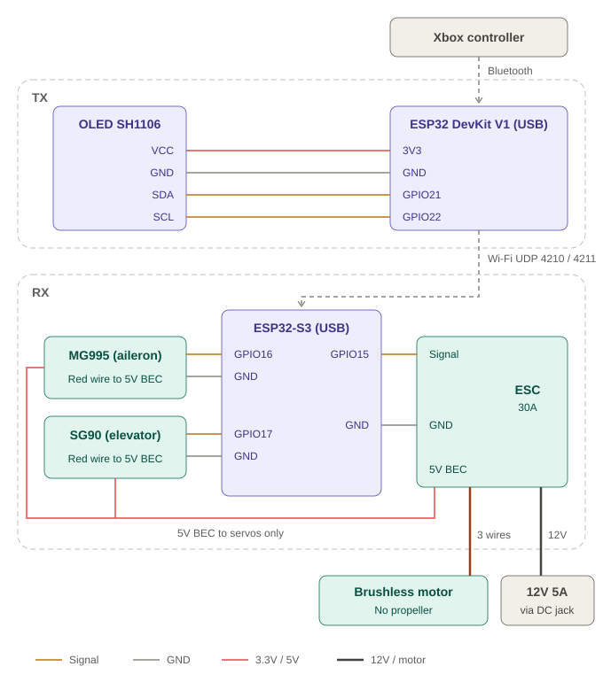

# Xbox Drone Control — Experiment 3

Wireless brushless motor + control surfaces driven by an Xbox Series controller over two ESP32 boards (Wi-Fi/UDP), with telemetry, failsafe and a live web dashboard.

> **بالعربي:** تطوير لتجربة 3 بمادة Drone Communication Systems. بدل البوتنشيوميتر، يدة إكس بوكس تتحكم بماتور برشلس وسيرفوين (Aileron وElevator) عن طريق ESP32 اثنين بالواي فاي، مع Arm/Kill مثل الدرونات، وFailsafe، وتيليمتري (RTT وRSSI)، وشاشة OLED، وداشبورد حي على الموبايل، وفحص Pre-flight، واهتزاز اليدة حسب الثروتل.

Drone Communication Systems — Experiment 3 (extended version)
Mohammed Isam Yousif — Department of Space and UAV Engineering Techniques, Middle Technical University

The original lab uses a potentiometer on an ESP8266 to send a throttle value over Wi-Fi/UDP to a second
ESP8266 that drives an ESC. This version keeps the same link (AP `ESP_MOTOR_CTRL`, UDP port 4210,
1000–1200 µs throttle limit, 500 ms failsafe) and extends it into a small aircraft control system:

- Xbox Series controller over Bluetooth (Bluepad32) instead of the potentiometer
- Throttle + aileron (MG995) + elevator (SG90)
- ARM (hold A 1.5 s, throttle released) and KILL (B), like a real drone
- 50 Hz commands, telemetry back to the TX (round-trip latency + RSSI)
- RX failsafe: no valid packet for 500 ms → throttle 1000 µs, servos centred
- OLED status screen on the TX, RGB status LED on the RX
- Live web dashboard (aircraft model, gauges, latency graph, ARM/KILL)
- Pre-flight check on X (servo sweep, only when SAFE)
- Pad rumble that follows the throttle while ARMED

## Repository layout

| Folder | Board | Role |
|---|---|---|
| `firmware/EXP3_TX_Xbox/` | ESP32 DevKit V1 | Ground side: Xbox pad, OLED, Wi-Fi AP, dashboard (v1.2.0) |
| `firmware/EXP3_RX_S3/` | ESP32-S3 DevKitC (N8R2) | Aircraft side: ESC + 2 servos, failsafe, telemetry (v1.0.0) |
| `docs/wiring.svg` | — | Full wiring diagram |
| `docs/lab-questions.md` | — | Answers to the 5 lab questions + results table |

## Wiring

**TX — ESP32 DevKit V1 + OLED SH1106 1.3"**

| OLED | ESP32 |
|---|---|
| VCC | 3V3 |
| GND | GND |
| SDA | GPIO21 |
| SCL | GPIO22 |

**RX — ESP32-S3**

| From | To |
|---|---|
| ESC signal (yellow) | GPIO15 |
| MG995 signal (orange) — aileron | GPIO16 |
| SG90 signal (orange) — elevator | GPIO17 |
| ESC brown + servo browns | GND pins (common ground) |
| ESC red (5V BEC) | servo red wires only — never to the ESP |

**Power**

- 12 V 5 A adapter → DC jack → ESC thick red (+) / black (−)
- ESC 3 thick wires → brushless motor (swap any two to reverse)
- Both ESP boards powered by USB
- No propeller during bench tests

## Arduino IDE settings

**TX (ESP32 DevKit V1)**
- Boards Manager URL: `https://raw.githubusercontent.com/ricardoquesada/esp32-arduino-lib-builder/master/bluepad32_files/package_esp32_bluepad32_index.json`
- Board: `esp32_bluepad32 → ESP32 Dev Module`
- Partition Scheme: `Huge APP (3MB No OTA/1MB SPIFFS)`
- Libraries: Adafruit SH110X, Adafruit GFX

**RX (ESP32-S3)**
- Board: `ESP32S3 Dev Module` — Flash 8MB, PSRAM Disabled (or QSPI), USB CDC On Boot Disabled
- Upload through the port labelled COM
- Library: ESP32Servo
- If the board is selected from the bluepad32 package, do not call `WiFi.setSleep(false)` (Wi-Fi + BT coexistence abort)

## Use

1. Power the TX, press the Xbox pair button until the logo blinks fast (pad rumbles when connected).
2. Power the RX — it joins `ESP_MOTOR_CTRL` with static IP 192.168.4.2. OLED shows `LINK:OK`.
3. Plug the 12 V adapter with the system SAFE (ESC arming tones).
4. Dashboard: join Wi-Fi `ESP_MOTOR_CTRL` (password `motor123`) and open `http://192.168.4.1`.

| Control | Action |
|---|---|
| RT | Throttle 1000–1200 µs |
| Left stick X / Y | Aileron / elevator |
| Hold A 1.5 s | ARM (throttle must be released) |
| B | KILL / disarm (also aborts the pre-flight check) |
| X | Pre-flight check (SAFE only) |

## Packet format

- TX → RX (port 4210): `C,seq,timestamp,throttle,aileron,elevator,armed`
- RX → TX (port 4211, every 5th packet): `T,echoTimestamp,rssi` → TX computes round-trip latency

## Bill of materials

| Part | Qty |
|---|---|
| ESP32 DevKit V1 | 1 |
| ESP32-S3 DevKitC (N8R2) | 1 |
| Xbox Series X/S controller | 1 |
| OLED 1.3" SH1106 I2C | 1 |
| Brushless motor + 30A ESC (with BEC) | 1 |
| MG995 servo, SG90 servo | 1 each |
| 12 V 5 A adapter + 5.5×2.1 mm DC jack | 1 |
| Male-female / female-female jumpers | — |

## Safety

Bench prototype only — not a flight-ready control system. Remove the propeller, secure the motor,
disconnect power before rewiring, never apply 12 V or the BEC 5 V to an ESP pin.

## Note

The RX code replaces the PTS-3030C tracker firmware on the same ESP32-S3. To restore the tracker,
re-flash it from the Sel-nilink repo (`hardware/tracker_interim_pts3030c/`).
